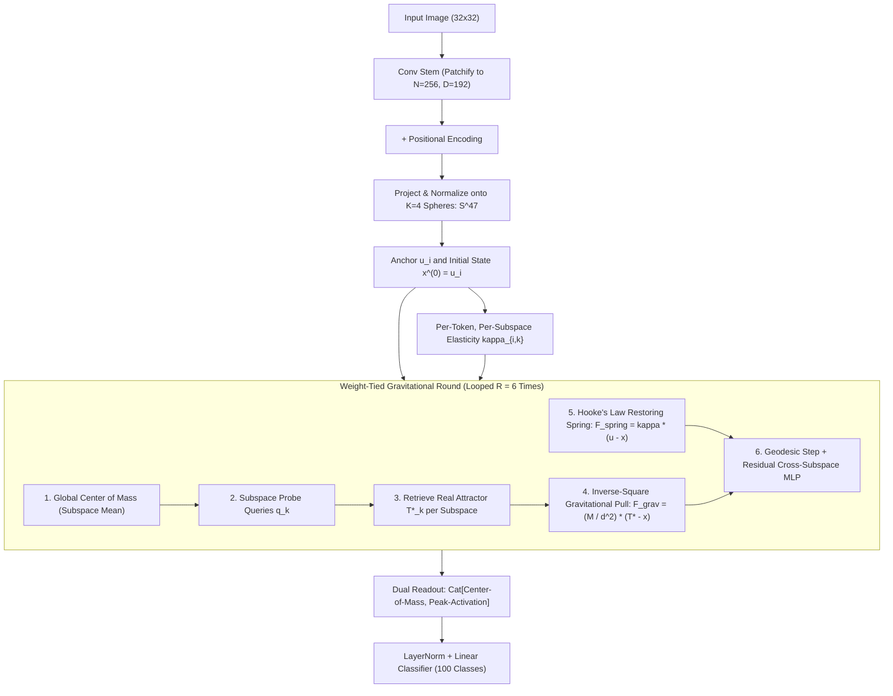

# Gravitational Attention Networks

> **Replacing Pairwise Self-Attention with Gravito-Elastic Field Dynamics on Orthogonal Hyperspheres**

[](https://pytorch.org)
[](LICENSE)

---

## 1. The Core Idea: Field Dynamics on Hyperspheres

Traditional neural networks (Transformers, MLPs, ResNets) rely on unconstrained affine transformations at every depth:
$$\mathbf{x}^{(l+1)} = \sigma(\mathbf{W}^{(l)} \mathbf{x}^{(l)} + \mathbf{b}^{(l)})$$
By layer $L$, the geometric coordinate manifold has been continuously stretched, warped, and destroyed.

**Gravitational Attention Networks** propose a fundamental paradigm shift:
Tokens are treated as **discrete physical particles residing on a permanent compact manifold**—specifically, a Cartesian product of $K$ orthogonal unit hyperspheres:
$$\mathcal{M} = \mathbb{S}^{d_1-1} \times \mathbb{S}^{d_2-1} \times \dots \times \mathbb{S}^{d_K-1}, \quad \text{where } d_k = \frac{D}{K}$$

Tokens never leave these spherical surfaces. Instead of layer-wise transformation, tokens **migrate** across the surface of the hyperspheres governed by classical equations of motion until they reach dynamic equilibrium:

$$\Delta \mathbf{x}_i \propto \mathbf{F}_{\text{net}, i} = \eta \mathbf{F}_{\text{gravity}, i} + \mathbf{F}_{\text{Hooke}, i}$$

```
                +-------------------------------------------+
                |           Unit Hypersphere S^(d-1)        |
                |                                           |
     Anchor     |      Hooke Restoring Force F_spring       |
       u_i  o===|==================================>        |
                |                                   \       |
                |                                    x_i    |  Token particle
                |                                   /       |
                |      Inverse-Square Gravity      v        |
                |   <==============================o        |
                |                                  T*       |  Winning Attractor
                +-------------------------------------------+
```

---

## 2. The Three Physical Pillars

1. **Gravitational Pull Toward Retrieved Real Tokens ($T^*$):**
   Instead of computing an $O(N^2)$ all-pairs attention matrix or pulling tokens toward synthetic centroids, each subspace generates a probe query $\mathbf{q}_k$ from the collective field average, identifies the **best-matching real token $T^*_k$**, and endows it with learnable mass $M_k$. Every token $\mathbf{x}_i$ is pulled toward $T^*_k$ via an inverse-square force law in $O(N)$ linear time:
   $$\mathbf{F}_{\text{grav}, i, k} = \frac{M_k}{d_{i, k}^2} \left(\mathbf{t}^*_k - \mathbf{x}_{i, k}\right), \quad d_{i, k}^2 = 2 - 2\langle \mathbf{x}_{i, k}, \mathbf{t}^*_k \rangle + \epsilon$$

2. **Hooke's Law Elastic Anchoring ($\mathbf{u}_i$):**
   Pure gravitational attraction causes total collapse into a single point/singularity (over-smoothing). To preserve identity and topology, every token is tethered to its initial coordinate $\mathbf{u}_i$ (patch embedding + position) via a virtual spring exerting a restoring force:
   $$\mathbf{F}_{\text{spring}, i, k} = \kappa_{i, k} (\mathbf{u}_{i, k} - \mathbf{x}_{i, k})$$
   Each token predicts its own dynamic spring constant $\kappa_{i, k} \in (0, 1)$, allowing structural/foreground regions to stay rigid ($\kappa \to 1$) while contextual/background regions remain fluid ($\kappa \to 0$).

3. **Orthogonal Subspace Multi-Body Dynamics:**
   When $K$ attractors pull inside the *same* vector space, opposing force vectors collide and cancel each other out (**destructive interference**). By decomposing the $D$-dimensional space into $K$ mutually orthogonal hyperspheres $\mathbb{S}^{d_k-1}$, $K$ independent gravitational bodies pull tokens along perpendicular degrees of freedom with **zero vector cancellation**.

---

## 3. Current Architecture

The architecture uses **one single weight-tied recurrent module** (`OrthogonalVisionRound`) unrolled iteratively for $R$ rounds ($R=6$):



---

## 4. Key Results & Physics Ablations (CIFAR-100)

Trained on CIFAR-100 ($N=256$ patches, $D=192$, $K=4$ orthogonal $48$-D spheres, 6 shared rounds) for 40 epochs:

* **Parameters:** **351,568**
* **Top-1 Accuracy:** **59.22%**
* **Top-5 Accuracy:** **85.32%**

### Physics Ablations (Epoch 40, Zero Retraining)
Evaluating the model while isolating each physical force demonstrates that the network organizes its core computation around the physical field:

| Configuration | Top-1 Accuracy | Top-5 Accuracy | Delta vs. Full | Physical Interpretation |
| :--- | :---: | :---: | :---: | :--- |
| **Full Orthogonal Model** | **59.22%** | **85.32%** | — | Balanced gravito-elastic field dynamics |
| **Gravity Disabled ($\eta = 0$)** | **10.04%** | — | **-49.18%** | Field dynamics do ~85% of classification work |
| **Uniform Springs ($\kappa = 0.5$)** | **30.08%** | — | **-29.14%** | Elasticity differentiation is critical for perception |
| **Springs Disabled ($\kappa = 0$)** | **1.22%** | — | **-58.00%** | Complete collapse into a gravitational singularity |

---

## 5. Emergent Visual Discoveries

### Emergent Object Shadows (Unsupervised Segmentation)
Without any segmentation supervision, structural foreground tokens automatically assign themselves near-maximum stiffness ($\kappa \to 1.0$), remaining fixed near their anchors, while fluid background tokens are dragged across the hypersphere toward the attractor:


### Subspace Division of Labor & Dual Push-Pull Masks
Inspecting the 4 orthogonal spheres reveals functional division of labor: Subspace 4's attractor ($T^*_4$, yellow dot) consistently locks onto the primary object center, while Subspaces 1–3 anchor to peripheral boundaries. In addition, Subspaces 1 and 4 exhibit complementary push-pull elasticity masks (center-surround antagonism):


---

## 6. Repository Structure

```
├── experiments/
│   └── cifar100_orthogonal_vision.py  # Standalone CIFAR-100 training, ablation & visualizer
├── results/
│   ├── emergent_object_shadows.png         # Unsupervised figure-ground segmentation heatmaps
│   └── subspace_elasticity_partitioning.png # 4-subspace attractor & elasticity analysis
├── README.md
└── .gitignore
```

---

## 7. Quick Start

### Installation
```bash
pip install torch torchvision datasets matplotlib numpy
```

### Reproduce CIFAR-100 (40 Epochs)
```bash
python experiments/cifar100_orthogonal_vision.py
```
This script loads the dataset directly into GPU VRAM, trains the 351k-parameter model for 40 epochs (~2.5s/epoch on modern GPUs), executes the physics ablation suite, and saves the diagnostic heatmaps to `results/`.
