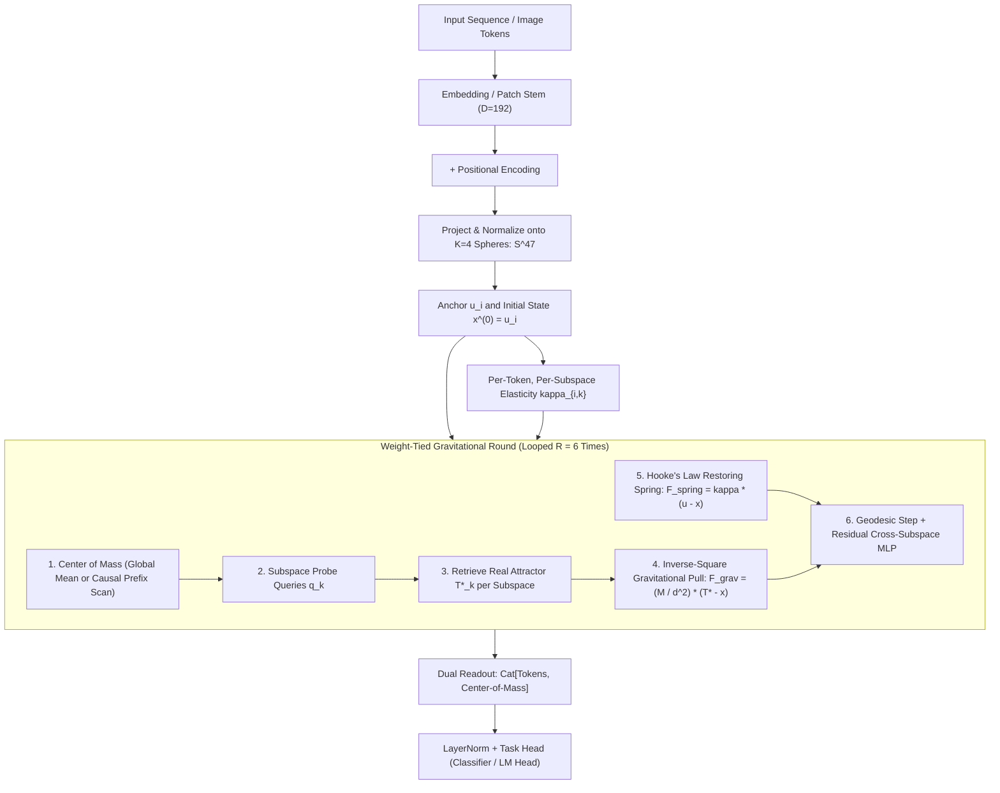
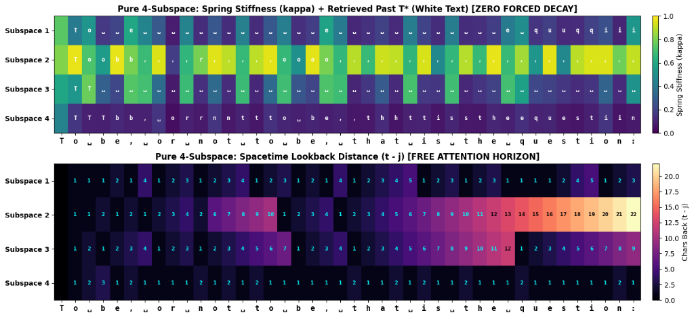

# Gravitational Attention Networks

> **Replacing Pairwise Self-Attention with Gravito-Elastic Field Dynamics on Orthogonal Hyperspheres**

[](https://pytorch.org)
[](LICENSE)

---

## 1. The Core Idea: Field Dynamics on Hyperspheres

Traditional neural networks (Transformers, MLPs, ResNets) rely on unconstrained affine transformations at every depth:

$$
\mathbf{x}^{(l+1)} = \sigma\left(\mathbf{W}^{(l)} \mathbf{x}^{(l)} + \mathbf{b}^{(l)}\right)
$$

By layer $L$, the geometric coordinate manifold has been continuously stretched, warped, and destroyed.

**Gravitational Attention Networks** propose a fundamental paradigm shift:
Tokens are treated as **discrete physical particles residing on a permanent compact manifold**—specifically, a Cartesian product of $K$ orthogonal unit hyperspheres:

$$
\mathcal{M} = \mathbb{S}^{d_1-1} \times \mathbb{S}^{d_2-1} \times \dots \times \mathbb{S}^{d_K-1}, \quad \text{where } d_k = \frac{D}{K}
$$

Tokens never leave these spherical surfaces. Instead of layer-wise transformation, tokens **migrate** across the surface of the hyperspheres governed by classical equations of motion until they reach dynamic equilibrium:

$$
\Delta \mathbf{x}_i \propto \mathbf{F}_{\text{net}, i} = \eta \mathbf{F}_{\text{gravity}, i} + \mathbf{F}_{\text{Hooke}, i}
$$

```
                +-------------------------------------------+
                |           Unit Hypersphere S^(d-1)        |
                |                                           |
     Anchor     |      Hooke Restoring Force F_spring       |
       u_i  o===|==================================>        |
                |                                   \       |
                |                                    x_i    |  Token particle
                |                                   /       |
                |      Inverse-Square Gravity      v        |
                |   <==============================o        |
                |                                  T*       |  Winning Attractor
                +-------------------------------------------+
```

---

## 2. The Three Physical Pillars

### 2.1 Gravitational Pull Toward Retrieved Real Tokens ($T^\ast$)

Instead of computing an $O(N^2)$ all-pairs attention matrix or pulling tokens toward synthetic centroids, each subspace generates a probe query $\mathbf{q}_k$ from the collective field average, identifies the best-matching real token $T_k^\ast$, and endows it with learnable mass $M_k$. Every token $\mathbf{x}_i$ is pulled toward $T_k^\ast$ via an inverse-square force law in $O(N)$ linear time:

$$
\mathbf{F}_{\text{grav}, i, k} = \frac{M_k}{d_{i, k}^2} \left(\mathbf{t}_k^\ast - \mathbf{x}_{i, k}\right), \quad d_{i, k}^2 = 2 - 2\langle \mathbf{x}_{i, k}, \mathbf{t}_k^\ast \rangle + \epsilon
$$

### 2.2 Hooke's Law Elastic Anchoring ($\mathbf{u}_i$)

Pure gravitational attraction causes total collapse into a single point/singularity (over-smoothing). To preserve identity and topology, every token is tethered to its initial coordinate $\mathbf{u}_i$ (patch embedding + position) via a virtual spring exerting a restoring force:

$$
\mathbf{F}_{\text{spring}, i, k} = \kappa_{i, k} (\mathbf{u}_{i, k} - \mathbf{x}_{i, k})
$$

Each token predicts its own dynamic spring constant $\kappa_{i, k} \in (0, 1)$, allowing structural/foreground regions to stay rigid ($\kappa \to 1$) while contextual/background regions remain fluid ($\kappa \to 0$).

### 2.3 Orthogonal Subspace Multi-Body Dynamics

When $K$ attractors pull inside the *same* vector space, opposing force vectors collide and cancel each other out (**destructive interference**). By decomposing the $D$-dimensional space into $K$ mutually orthogonal hyperspheres $\mathbb{S}^{d_k-1}$, $K$ independent gravitational bodies pull tokens along perpendicular degrees of freedom with **zero vector cancellation**.

---

## 3. Current Architecture

The architecture uses **one single weight-tied recurrent module** (`OrthogonalVisionRound` / `PureOrthogonalCausalRound` / `LinearCausalGravitationalRound`) unrolled iteratively for $R$ rounds ($R=6$):



---

## 4. Vision Benchmarks & Physics Ablations (CIFAR-100)

Trained on CIFAR-100 ($N=256$ patches, $D=192$, $K=4$ orthogonal $48$-D spheres, 6 shared rounds) for 40 epochs:

* **Parameters:** **351,568**
* **Top-1 Accuracy:** **59.22%**
* **Top-5 Accuracy:** **85.32%**

### Physics Ablations (CIFAR-100 Epoch 40, Zero Retraining)
Evaluating the model while isolating each physical force demonstrates that the network organizes its core computation around the physical field:

| Configuration | Top-1 Accuracy | Top-5 Accuracy | Delta vs. Full | Physical Interpretation |
| :--- | :---: | :---: | :---: | :--- |
| **Full Orthogonal Model** | **59.22%** | **85.32%** | — | Balanced gravito-elastic field dynamics |
| **Gravity Disabled ($\eta = 0$)** | **10.04%** | — | **-49.18%** | Field dynamics do ~85% of classification work |
| **Uniform Springs ($\kappa = 0.5$)** | **30.08%** | — | **-29.14%** | Elasticity differentiation is critical for perception |
| **Springs Disabled ($\kappa = 0$)** | **1.22%** | — | **-58.00%** | Complete collapse into a gravitational singularity |

---

## 5. Emergent Visual Discoveries

### Emergent Object Shadows (Unsupervised Segmentation)
Without any segmentation supervision, structural foreground tokens automatically assign themselves near-maximum stiffness ($\kappa \to 1.0$), remaining fixed near their anchors, while fluid background tokens are dragged across the hypersphere toward the attractor:


### Subspace Division of Labor & Dual Push-Pull Masks
Inspecting the 4 orthogonal spheres reveals functional division of labor: Subspace 4's attractor ($T_4^\ast$, yellow dot) consistently locks onto the primary object center, while Subspaces 1–3 anchor to peripheral boundaries. In addition, Subspaces 1 and 4 exhibit complementary push-pull elasticity masks (center-surround antagonism):


---

## 6. Language Modeling Progression: 1-Body vs. 4-Subspace

Across iterative experiments on Tiny Shakespeare (1.11M characters, vocab 65, context $T=128$, $D=192$, 6 shared rounds, 10 epochs), we tracked the architecture across three rigorous stages:

| Model Architecture | Parameters | Val Loss | Next-Char Accuracy | Key Emergent Behavior |
| :--- | :---: | :---: | :---: | :--- |
| **Pure 1-Body Model**<br>*(1 Sphere $\mathbb{S}^{191}$, 1 Query, Zero Decay)* | 248,516 | 1.638 | 52.16% | Solid baseline; forced to compromise between local spelling and global syntax. |
| **Pure 4-Subspace Model**<br>*(4 Spheres $\mathbb{S}^{47}$, Zero Forced Decay)* | 249,101 | 1.605 | 52.57% | Spontaneous discovery of word-boundary staircases (S1), spelling spine (S4), and clause anchors (S2). |
| **Linear 4-Subspace Model**<br>*(Exact Exponential Cancellation)* | 249,105 | 1.583 | 53.60% | Strictly $O(T)$ linear-time prefix scan with learned decay horizons. |

---

## 7. Pure Orthogonal Subspaces: Zero Forced Decay & Spontaneous Organization

To test whether the architecture requires hand-crafted inductive biases or if the physics self-organizes from first principles, we completely removed all temporal decay ($\gamma = 0$) and initialized all 4 subspaces identically and uniformly.

Every token was given a completely unconstrained attention horizon across the past light-cone ($j < t$).

### 7.1 Spontaneous Linguistic Division of Labor
Evaluating the unforced model on Hamlet's *"To be, or not to be, that is the question:"* revealed remarkable spontaneous specialization:



1. **Subspace 1 (Unsupervised Word-Boundary Staircases):**
   Without any tokenizer or decay penalty, Subspace 1's lookback distance naturally counts characters inside each word, resetting at word onsets:
   * `_ o r`: lookback counts **1 $\to$ 2 $\to$ 3**
   * `_ n o t`: lookback counts **1 $\to$ 2 $\to$ 3 $\to$ 4**
   * `_ t o`: lookback counts **1 $\to$ 2 $\to$ 3**
   * `_ t h a t`: lookback counts **1 $\to$ 2 $\to$ 3 $\to$ 4 $\to$ 5**
2. **Subspace 4 (Dominant Markovian Spelling Spine):**
   Subspace 4 self-selected the strongest gravity in the network ($M_4 = 1.0589, \eta_4 = 0.8664$) and made its springs fluid ($\kappa \approx 0.1$). Its lookback distance locked into an unbroken stream of **`1`s and `2`s**, acting as the high-speed local spelling engine.
3. **Subspace 2 (Rigid Grammatical & Clause Anchor):**
   Subspace 2 assigned itself maximum spring stiffness ($\kappa \to 1.0$), making it completely rigid. It reached up to **22 characters back**, anchoring exclusively onto commas (`,`), spaces (`␣`), and clause boundaries to provide grammatical scaffolding.

### 7.2 Physics Ablation (Pure 4-Subspace Model, Zero Decay)

| Configuration | Val Loss | Next-Char Accuracy | Delta vs. Full | Physical Meaning |
| :--- | :---: | :---: | :---: | :--- |
| **Full Pure 4-Subspace Model** | **1.605** | **52.57%** | — | Unconstrained multi-body equilibrium |
| **Constant Spring ($\kappa = 0.5$)** | **2.595** | **30.42%** | **-22.15%** | Fluid/stiff differentiation accounts for >22% accuracy |
| **Gravity Disabled ($\eta = 0$)** | **4.829** | **10.95%** | **-41.62%** | Without gravitational attraction, tokens cannot interact |
| **Springs Disabled ($\kappa = 0$)** | **6.615** | **7.31%** | **-45.25%** | Complete collapse into a gravitational singularity |

---

## 8. Strictly $O(T)$ Linear Formulation via Exponential Cancellation

When temporal horizon decay $\gamma_k$ is introduced, the system unlocks a mathematical identity that reduces causal attention to **strictly $O(T)$ linear time and linear memory with ZERO $T \times T$ matrices**.

### 8.1 Exact Exponential Cancellation Derivation
In the past light-cone ($j < t$), query-token match scores decay with learned temporal horizon $\gamma_k$:

$$
\text{Score}(t, j) = s_j - \gamma_k (t - j) = s_j - \gamma_k t + \gamma_k j
$$

When evaluating normalized softmax weights over past tokens:

$$
w_{t, j} = \frac{\exp\left(s_j - \gamma_k(t - j)\right)}{\sum_{j < t} \exp\left(s_j - \gamma_k(t - j)\right)} = \frac{\exp(-\gamma_k t) \cdot \exp(s_j + \gamma_k j)}{\exp(-\gamma_k t) \cdot \sum_{j < t} \exp(s_j + \gamma_k j)} = \frac{\exp(s_j + \gamma_k j)}{\sum_{j < t} \exp(s_j + \gamma_k j)}
$$

Because the term $\exp(-\gamma_k t)$ is strictly independent of index $j$, **it factors out of both the numerator and denominator and cancels completely**. 

Consequently, the retrieved past attractor $\mathbf{t}_{t, k}^\ast$ reduces to a cumulative prefix sum (`cumsum`):

$$
\mathbf{t}_{t, k}^\ast = \text{Normalize}\left(\frac{\sum_{j < t} \exp(s_j + \gamma_k j) \mathbf{x}_{j, k}}{\sum_{j < t} \exp(s_j + \gamma_k j)}\right)
$$

This operates in **strictly $O(T)$ time and memory**. No $T \times T$ attention matrix is ever materialized.


---

## 9. Repository Structure

```
├── experiments/
│   ├── cifar100_orthogonal_vision.py        # 2D Vision: CIFAR-100 training, ablation & visualizer
│   ├── shakespeare_causal_lm.py             # 1D Causal LM: Strictly O(T) linear prefix-scan model
│   └── shakespeare_causal_lm_pure.py        # 1D Causal LM: Pure unforced orthogonal model (Zero decay)
├── results/
│   ├── emergent_object_shadows.png           # 2D Vision: Unsupervised figure-ground segmentation heatmaps
│   ├── subspace_elasticity_partitioning.png   # 2D Vision: 4-subspace attractor & elasticity analysis
│   ├── causal_lm_shakespeare_analysis.png    # 1D Causal LM: O(T) linear model lookback analysis
│   └── pure_subspace_shakespeare_analysis.png# 1D Causal LM: Pure unforced model lookback & word staircases
├── README.md
└── .gitignore
```

---

## 10. Quick Start

### Installation
```bash
pip install torch torchvision datasets matplotlib numpy
```

### 1. Run 2D Vision Benchmark (CIFAR-100, 40 Epochs)
```bash
python experiments/cifar100_orthogonal_vision.py
```

### 2. Run Pure Unforced Causal LM (Zero Decay, 10 Epochs)
```bash
python experiments/shakespeare_causal_lm_pure.py
```

### 3. Run Strictly $O(T)$ Linear Causal LM (Exponential Cancellation, 10 Epochs)
```bash
python experiments/shakespeare_causal_lm.py
```

All scripts load datasets directly into GPU VRAM, verify mathematical physics invariants (causality checks, geodesic normalization), execute full physics ablation suites, and save high-resolution diagnostic heatmaps to `results/`.
